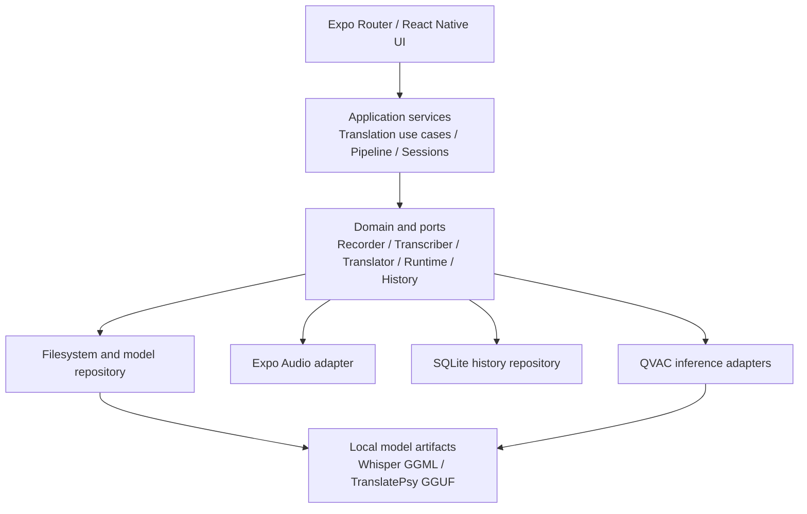
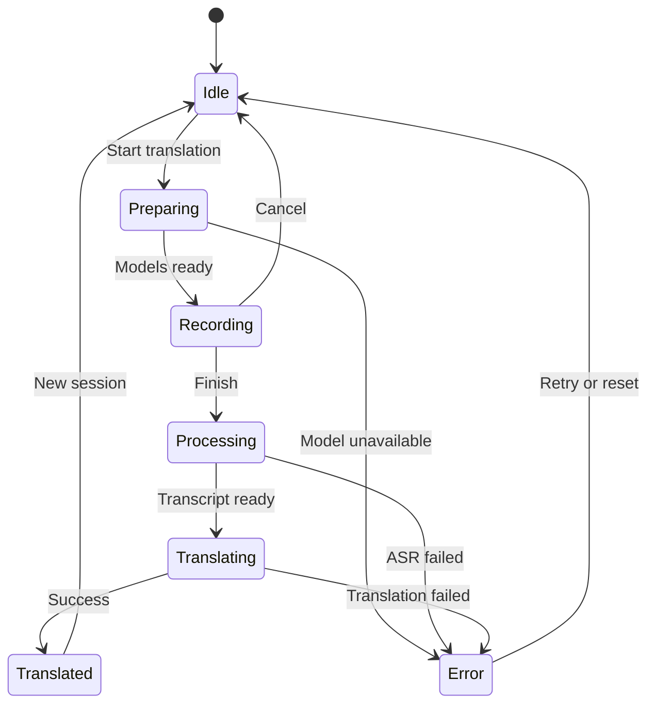
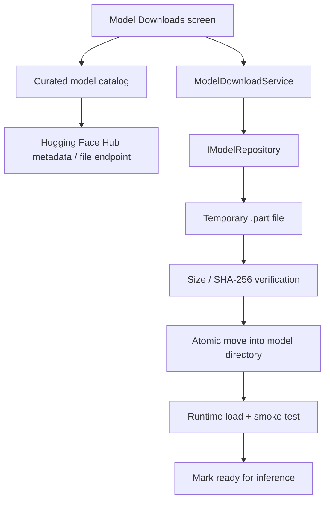
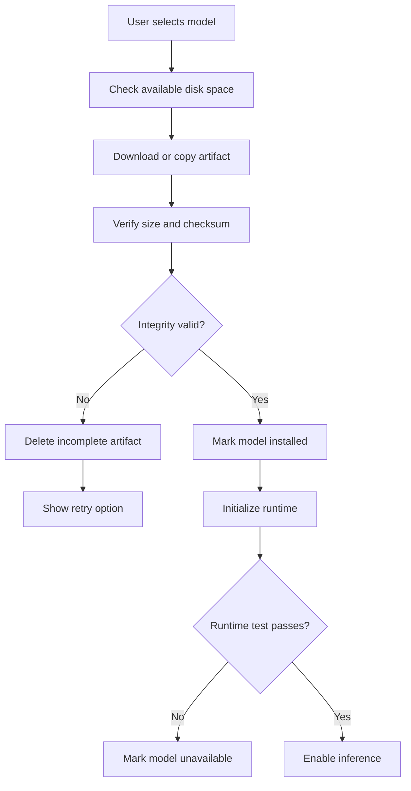

# Ndimi Swahili — Complete Technical Architecture

**Document type:** Technical architecture and implementation plan  
**Platform:** Android-first, Expo / React Native  
**Inference:** On-device using QVAC-compatible native runtimes  
**Product principles:** Swahili-first, offline-capable, privacy-preserving

---

## 1. Executive Summary

Ndimi Swahili is a private, on-device multilingual translator. The initial release focuses on English ↔ Swahili text translation and recorded speech translation. It uses Expo Router and React Native for the user interface, QVAC for native model inference where compatible, SQLite for local history, and app-managed local storage for model files.

The visual direction follows the supplied UI reference: soft pastel gradients, translucent white surfaces, rounded cards, minimal icons, spacious typography, and a simple voice-recording experience.

### Proposed model candidates

- **ASR:** [Whisper Swahili Small GGML](https://huggingface.co/malinali-app/whisper-swahili-small-ggml/tree/main)
- **Translation:** [QVAC TranslatePsy-AfriSLM collection](https://huggingface.co/collections/qvac/translatepsy-afrislm)
- **Initial translation benchmark candidate:** TranslatePsy-AfriSLM 0.8B Q4 GGUF, subject to runtime compatibility, model licence, and quality testing.

**Important:** Repository availability does not prove that a particular artifact works with the exact installed QVAC SDK, Android ABI, or inference plugin. Prove both model paths on a physical device before committing to the full implementation.

---

## 2. Product Goals and Scope

### Goals

1. Transcribe speech locally.
2. Translate text locally between supported languages.
3. Work offline after required models are installed.
4. Keep audio, transcripts, and translations on the device.
5. Provide a clean, accessible UI based on the supplied reference.
6. Keep core application logic independent of Expo and QVAC implementation details.
7. Support model versioning, integrity checks, local history, cancellation, and error recovery.

### Initial release

| Feature | Release 1 |
|---|---|
| English ↔ Swahili text translation | Yes, after model validation |
| Recorded speech → transcript → translation | Yes |
| Offline inference after model installation | Yes |
| Translation history | Yes |
| Model download and storage management | Yes |
| Live simultaneous interpretation | Later |
| Camera / OCR translation | Later |
| Speaker diarization | Later |
| P2P model sharing | Later |
| LLM-assisted translation fallback | Later, only if benchmarks justify it |

The reference UI also contains camera scanning, an assistant shortcut, and profile/account elements. These can be represented in the design system, but they should not expand the first release beyond the core translation workflow.

---

## 3. Visual Design System

### Design direction

Use the supplied three-screen UI as the visual reference:

- Soft pastel gradients with blush, lavender, and mint tones.
- White or translucent cards with rounded corners.
- Minimal line icons and subtle shadows.
- Spacious typography and generous whitespace.
- A prominent microphone control and animated waveform on the voice screen.
- Clear language selectors and a distinct source/translated-text hierarchy.

### Suggested design tokens

```ts
// src/theme/tokens.ts
export const tokens = {
  colors: {
    background: '#F7F3FA',
    surface: '#FFFFFF',
    text: '#24212B',
    secondaryText: '#777180',
    primary: '#B69AE8',
    accentPink: '#F5C9DF',
    accentMint: '#CDEDE3',
    border: '#EAE4EF',
    danger: '#C94355',
  },
  radius: {
    card: 24,
    input: 18,
    button: 20,
    pill: 999,
  },
  spacing: {
    xs: 4,
    sm: 8,
    md: 16,
    lg: 24,
    xl: 32,
  },
};
```

Treat the reference image as a visual specification, not as a requirement to copy every label. Use Ndimi Swahili branding, actual language choices, and honest offline/model status indicators.

### Screen specifications

#### Home — `app/(tabs)/index.tsx`

- Ndimi Swahili branding and settings/profile action.
- Main text-entry entry point.
- Primary actions: **Translate Text** and **Voice Translate**.
- Compact model readiness indicator.
- Recent translations.
- Minimal bottom navigation.

#### Translate AI — `app/(tabs)/translate.tsx`

- Source and target language selectors with a swap action.
- Large source text input.
- Translate button with loading state.
- Source and translated text displayed distinctly.
- Copy, clear, save, and share actions.
- Clear offline/model-not-ready messaging.

#### Voice Chat — `app/(tabs)/voice.tsx`

- Language pair visible at the top.
- Large animated waveform.
- Recording duration and listening indicator.
- Microphone control with cancel and finish actions.
- Separate transcribing and translating progress states.
- Result view with original transcript and translated text.

#### Model Downloads — `app/(tabs)/models.tsx`

This is a dedicated, first-class screen for discovering, downloading, installing, updating and removing models from Hugging Face. Model management happens inside the app; users should not need to open a browser or manually copy model files.

The screen should include:

- A model catalog with task filters: **Speech recognition (ASR)** and **Translation**.
- Curated model entries for the Whisper Swahili GGML artifact and supported TranslatePsy-AfriSLM variants.
- Model name, task, supported languages, artifact format, quantization, download size, licence, publisher/repository and compatibility status.
- A clear **Download** action and download progress (bytes and percentage where known).
- Pause/cancel where supported, retry, and recovery after app restarts or interrupted downloads.
- Downloaded, downloading, verifying, installed, update available and failed states.
- Storage usage, delete/uninstall action, and a warning if a model is currently in use.
- A distinction between “downloaded” and “ready to use”: validate integrity, runtime compatibility and a smoke test before marking a model ready.
- Wi-Fi-only preference and a confirmation before large downloads on mobile data.
- An offline state explaining that remote catalog discovery requires connectivity, while installed models remain usable offline.

The initial catalog can be curated in a local manifest so the app can always show known models and their expected metadata. When online, the app may refresh repository metadata from the Hugging Face Hub API. Do not present arbitrary repository files as compatible merely because they exist on Hugging Face. Only expose artifacts with a reviewed manifest and a verified runtime path.

#### History

- Search saved translations.
- Filter by language pair.
- Open a translation detail view.
- Delete individual records or clear all history.

#### Profile and settings

- Link to the dedicated Model Downloads screen and model storage summary.
- Offline mode and privacy controls.
- Language preferences.
- App information and licenses.
- An online account should not be required for core functionality.

---

## 4. System Architecture

The system has five logical layers:

1. **Presentation:** Expo Router, React Native components, UI state.
2. **Application:** translation use cases, pipeline orchestration, session management.
3. **Domain and ports:** language, translation, audio, model and history contracts.
4. **Inference adapters:** QVAC SDK, native model runtime, audio conversion.
5. **Persistence adapters:** SQLite, app filesystem, local model repository.

### Dependency rules

- Screens call application use cases.
- Application services depend on interfaces, not on Expo or QVAC implementation details.
- Platform adapters implement the interfaces.
- A bootstrap module constructs concrete implementations.
- Core application logic must not import `expo-*`, `react-native-*`, Node-only modules, or platform filesystem APIs.
- No inference request requires a backend server.

These boundaries make the core testable with fake implementations and reduce the cost of a future native Android adapter. They do not eliminate the need to verify native runtime compatibility.

### Architecture diagram



---

## 5. Proposed Repository Structure

```text
ndimi-sw/
├── app/
│   ├── _layout.tsx
│   ├── (tabs)/
│   │   ├── _layout.tsx
│   │   ├── index.tsx
│   │   ├── translate.tsx
│   │   ├── voice.tsx
│   │   ├── history.tsx
│   │   └── profile.tsx
│   ├── translation/
│   │   └── [id].tsx
│   └── settings/
│       ├── models.tsx
│       ├── privacy.tsx
│       └── languages.tsx
├── src/
│   ├── core/
│   │   ├── domain/
│   │   │   ├── Language.ts
│   │   │   ├── Translation.ts
│   │   │   ├── AudioArtifact.ts
│   │   │   └── ModelManifest.ts
│   │   ├── ports/
│   │   │   ├── IAudioRecorder.ts
│   │   │   ├── ITranscriber.ts
│   │   │   ├── ITranslator.ts
│   │   │   ├── IModelRuntime.ts
│   │   │   ├── IModelRepository.ts
│   │   │   ├── IFileSystem.ts
│   │   │   └── IHistoryRepository.ts
│   │   ├── services/
│   │   │   ├── TranslationService.ts
│   │   │   ├── ModelLifecycleService.ts
│   │   │   └── HistoryService.ts
│   │   ├── pipeline/
│   │   │   └── VoiceTranslatePipeline.ts
│   │   └── config/
│   │       └── ModelRegistry.ts
│   ├── platform/
│   │   └── mobile/
│   │       ├── audio/
│   │       │   └── ExpoAudioRecorder.ts
│   │       ├── inference/
│   │       │   ├── QvacRuntimeAdapter.ts
│   │       │   ├── QvacSttService.ts
│   │       │   └── QvacTranslationService.ts
│   │       ├── storage/
│   │       │   ├── ExpoFileSystem.ts
│   │       │   ├── SQLiteHistoryRepository.ts
│   │       │   └── LocalModelRepository.ts
│   │       └── bootstrap.ts
│   ├── features/
│   │   ├── translate/
│   │   ├── voice/
│   │   ├── history/
│   │   └── models/
│   │       ├── ModelDownloadsScreen.tsx
│   │       ├── ModelCatalog.tsx
│   │       └── DownloadItem.tsx
│   ├── components/
│   │   ├── GradientBackground.tsx
│   │   ├── GlassCard.tsx
│   │   ├── LanguageSelector.tsx
│   │   ├── TranslationResult.tsx
│   │   ├── VoiceWaveform.tsx
│   │   └── PrimaryButton.tsx
│   └── theme/
│       └── tokens.ts
├── assets/
├── tests/
│   ├── unit/
│   ├── integration/
│   └── fixtures/
├── qvac.config.json
├── app.json
├── package.json
└── README.md
```

This is a target structure, not a requirement to create every file immediately. Start with the runtime, ports, inference services and one working translation flow. Add modules as their use cases become real.

---

## 6. Model Architecture and Registry

### Selected candidates

**ASR:** [Whisper Swahili Small GGML repository](https://huggingface.co/malinali-app/whisper-swahili-small-ggml/tree/main)

**Translation:** [QVAC TranslatePsy-AfriSLM collection](https://huggingface.co/collections/qvac/translatepsy-afrislm)

Start by benchmarking a 0.8B Q4 GGUF translation variant. Compare it against a larger variant only after the smaller one works through the intended runtime.

Do not select a model solely by parameter count or quantization. Measure language quality, memory, latency, battery and thermal behavior on the target device.

### Model manifest contract

```ts
export interface ModelManifest {
  id: string;
  task: 'asr' | 'translation';
  source: 'bundled' | 'huggingface' | 'qvac-registry';
  format: 'ggml' | 'gguf' | 'other';
  languages: string[];
  localPath?: string;
  expectedBytes?: number;
  sha256?: string;
  licence?: string;
  runtimePlugin: string;
  verifiedOnDevice: boolean;
}
```

Populate exact filenames, checksums, sizes, licences and runtime identifiers from the actual model artifacts and SDK configuration. Do not invent these values.

The registry should also capture model version, language-pair support, minimum tested device class and any companion model requirements.

### Mandatory compatibility gate

Repository availability does not prove compatibility with a particular QVAC version.

Before implementation, verify:

1. Which QVAC plugin loads the selected Whisper GGML artifact.
2. Which QVAC plugin supports the TranslatePsy GGUF artifact.
3. The exact model-loading and inference signatures in the pinned SDK.
4. The translation model's required prompt/chat template and language identifiers.
5. The runtime's cancellation, unloading and error behavior.
6. Whether the artifacts work with the Android ABIs and native libraries in the build.

The GGUF translation model may use a generative inference path rather than a conventional NMT API. Do not assume that `modelType: 'nmt'` accepts a GGUF model without verification.

---

## 7. Core Application Contracts

The following are application-level interfaces, not copied QVAC SDK signatures.

### Audio artifact

```ts
// src/core/domain/AudioArtifact.ts
export interface AudioArtifact {
  uri: string;
  sampleRateHz: number;
  channels: number;
  encoding: 'pcm_s16le' | 'pcm_f32le';
  durationMs: number;
}
```

### Recorder

```ts
// src/core/ports/IAudioRecorder.ts
import type { AudioArtifact } from '../domain/AudioArtifact';

export interface IAudioRecorder {
  start(): Promise<void>;
  stop(): Promise<AudioArtifact>;
  cancel(): Promise<void>;
}
```

The adapter must guarantee the declared output format or explicitly convert the captured audio. Do not label an arbitrary encoded recording as PCM.

### Transcriber

```ts
// src/core/ports/ITranscriber.ts
import type { AudioArtifact } from '../domain/AudioArtifact';

export interface ITranscriber {
  transcribe(input: {
    audio: AudioArtifact;
    language?: string;
  }): Promise<{
    text: string;
    language?: string;
  }>;
}
```

### Translator

```ts
// src/core/ports/ITranslator.ts
export interface ITranslator {
  translate(input: {
    text: string;
    sourceLanguage: string;
    targetLanguage: string;
  }): Promise<{
    text: string;
  }>;
}
```

### Model runtime

```ts
// src/core/ports/IModelRuntime.ts
export interface IModelRuntime {
  load(modelId: string): Promise<void>;
  unload(modelId: string): Promise<void>;
  isLoaded(modelId: string): boolean;
}
```

Add `IModelRepository`, `IFileSystem`, and `IHistoryRepository` as separate ports. The model repository owns manifests, downloads, versions and integrity checks; the filesystem owns file operations and paths.

---

## 8. Voice Translation Pipeline

The pipeline coordinates application services. It should not expose QVAC calls directly to a screen.

```ts
import type { IAudioRecorder } from '../ports/IAudioRecorder';
import type { ITranscriber } from '../ports/ITranscriber';
import type { ITranslator } from '../ports/ITranslator';

export interface VoiceTranslateDependencies {
  recorder: IAudioRecorder;
  transcriber: ITranscriber;
  translator: ITranslator;
}

export class VoiceTranslatePipeline {
  constructor(
    private readonly deps: VoiceTranslateDependencies,
  ) {}

  async translateRecording(input: {
    sourceLanguage: string;
    targetLanguage: string;
  }) {
    const audio = await this.deps.recorder.stop();

    const transcript = await this.deps.transcriber.transcribe({
      audio,
      language: input.sourceLanguage,
    });

    if (!transcript.text.trim()) {
      throw new Error('No speech was recognized.');
    }

    const translation = await this.deps.translator.translate({
      text: transcript.text,
      sourceLanguage: input.sourceLanguage,
      targetLanguage: input.targetLanguage,
    });

    return {
      audio,
      sourceText: transcript.text,
      translatedText: translation.text,
      sourceLanguage: input.sourceLanguage,
      targetLanguage: input.targetLanguage,
    };
  }
}
```

This is illustrative orchestration, not a complete production implementation. In production, define whether the pipeline owns recording or receives an already-recorded artifact. Prefer separate `startRecording()` and `translateRecording()` operations coordinated by a session controller.

Add cancellation, explicit state transitions, model-readiness checks, cleanup and protection against stale results from cancelled sessions.

### Model loading policy

1. Load Whisper when the user enters voice translation.
2. Record and transcribe the utterance.
3. Release Whisper if memory pressure requires it.
4. Load TranslatePsy and translate the text.
5. Keep a model warm only if benchmarks show it is safe.
6. Unload models when leaving the workflow or when memory needs require it.

Text translation should bypass recording and ASR entirely.

---

## 9. Audio Capture and Processing

Use `expo-audio` for new recording work rather than starting a new implementation with deprecated `expo-av`.

The adapter must account for actual microphone sample rate, channel count and encoding. Convert or resample as necessary for the chosen Whisper runtime.

### Initial audio flow

1. Request microphone permission when the user starts recording.
2. Capture audio to an app-managed temporary file.
3. Convert to the exact format expected by the ASR adapter.
4. Invoke transcription.
5. Delete temporary audio after processing unless the user explicitly opts into retaining it.

Start with batch recording and transcription. Add voice activity detection and streaming only after the batch path is reliable.

Streaming transcription and streaming text generation do not automatically create a low-latency live interpreter. Partial transcripts can change, so schedule translation at sensible utterance or sentence boundaries rather than translating every incomplete fragment.

---

## 10. Translation State Machine



Production requirements:

- Represent Preparing, Recording, Transcribing and Translating explicitly.
- Use a session identifier so cancelled or outdated requests cannot overwrite newer results.
- Prevent unsafe concurrent inference if the runtime cannot support it.
- Propagate cancellation to native inference where supported.
- Clean up temporary files and release resources after failures.
- Show actionable errors for missing models, insufficient storage, permission denial and inference failures.

---

## 11. Local Persistence

Use `expo-sqlite` for translation history and user preferences.

### Initial schema

```sql
CREATE TABLE IF NOT EXISTS translations (
  id TEXT PRIMARY KEY NOT NULL,
  source_language TEXT NOT NULL,
  target_language TEXT NOT NULL,
  source_text TEXT NOT NULL,
  translated_text TEXT NOT NULL,
  input_type TEXT NOT NULL,
  model_id TEXT,
  created_at TEXT NOT NULL
);

CREATE INDEX IF NOT EXISTS idx_translations_created_at
ON translations(created_at DESC);

CREATE INDEX IF NOT EXISTS idx_translations_languages
ON translations(source_language, target_language);
```

`input_type` distinguishes text from speech. Store model identifiers for reproducibility. Do not retain raw audio by default.

The app should support searching history, opening a saved result, deleting individual entries and clearing all history.

---

## 12. In-App Hugging Face Model Downloads and Storage

Model acquisition is an in-app workflow with a dedicated **Model Downloads** screen. Users discover and install supported model artifacts from Hugging Face without leaving Ndimi Swahili. Downloading weights is the only planned network-dependent model operation; ASR and translation inference remain on-device.

### Download screen architecture



Recommended responsibilities:

- `ModelCatalogService`: returns curated model manifests and optionally refreshes metadata from Hugging Face.
- `ModelDownloadService`: manages progress, cancellation, retry, concurrency limits and recovery.
- `IModelRepository`: owns model artifact paths, installation state, versioning and deletion.
- `ModelIntegrityService`: verifies expected file size and SHA-256 where a trusted checksum is available.
- `ModelLifecycleService`: loads/unloads a verified installed model through the selected native runtime.
- `ModelDownloadsScreen`: displays state and invokes application actions; it must not contain raw download or QVAC logic.

### Download lifecycle

1. The user opens Model Downloads and selects a reviewed model variant.
2. The app checks available disk space and shows the expected download size and licence.
3. The user confirms the download; large mobile-data downloads should require explicit confirmation unless the user has changed the setting.
4. Download to a temporary filename in app-managed storage, not directly to the final model path.
5. Show progress and allow cancellation. Preserve a resumable partial file only when the download implementation can validate the existing byte range; otherwise remove it on retry.
6. Verify content length and checksum when available. Never claim cryptographic verification if the expected hash is not from a trusted manifest.
7. Atomically move the verified artifact into its final versioned directory.
8. Run a runtime compatibility/load smoke test. Only then mark the model **Ready**.
9. On failure, preserve a useful error state and prevent the artifact from being selected for inference.

Use HTTPS for Hugging Face downloads. Public repositories generally do not require a user token. Do not embed a private Hugging Face access token in the app binary. If gated/private repositories are ever supported, design an explicit secure authentication flow rather than shipping a secret in client code.

The model catalog should be curated first and dynamically refreshed second. Hugging Face repository metadata can change, filenames can be renamed, and repository files may not be compatible with QVAC. Pin the repository revision/commit and exact artifact path for reproducible installs. Store the model licence and attribution information for display.

### Separate storage categories

| Storage | Contents | Policy |
|---|---|---|
| App assets | Minimum bundled models, if chosen | Available offline immediately |
| Model directory | Downloaded weights and companion files | Versioned and integrity-checked |
| User data | Translation history and preferences | User-controlled retention and deletion |

### Model installation workflow



Support download progress, cancellation, retries and recovery after interrupted transfers. The UI should distinguish **Not downloaded**, **Downloading**, **Verifying**, **Installing**, **Ready**, **Update available** and **Failed**. Do not make an artifact eligible for inference until integrity checks and a runtime smoke test pass.

Start with HTTPS model downloads. P2P model sharing can be considered later after the core pipeline and privacy behavior are stable.

Measure the final APK/AAB size, installed model footprint, temporary disk usage and peak memory. Model weights are only part of the total runtime footprint.

---

## 13. Privacy and Security

Ndimi Swahili should treat privacy as a testable product requirement.

| Area | Required behavior |
|---|---|
| Audio | Process locally; delete temporary files after use |
| Transcripts | Store locally only as required for results or history |
| Translation | On-device inference through the selected runtime |
| Model downloads | User-initiated or clearly disclosed; integrity-checked |
| Analytics | None by default |
| Crash reporting | No automatic upload of user or device data |
| Permissions | Request microphone access only when needed |
| User deletion | Support complete deletion of translation history |
| Network | No inference network dependency after model installation |

Inspect third-party dependencies and network traffic. The absence of an analytics package does not prove that all dependencies are silent.

A true offline mode should disable model-network activity and continue to support all installed-model workflows.

---

## 14. Performance and Quality Testing

These are project targets to establish and refine through measurement, not claims about current performance.

### ASR quality

Test with a representative corpus containing:

- Kenyan Swahili and regional accents.
- English and Swahili code-switching.
- Proper nouns, place names, numbers and dates.
- Background noise and varying speaking speeds.
- Short commands and longer conversational utterances.

Measure word error rate and inspect common error patterns.

### Translation quality

Evaluate English → Swahili and Swahili → English separately. Include:

- Questions and negation.
- Idioms and everyday conversational expressions.
- Numbers, names and entities.
- Formal and informal language.
- Code-switched text.
- Meaning preservation and grammatical naturalness.

Use human review by competent Swahili speakers. Generic multilingual scores alone are insufficient.

### Runtime performance

Record:

- Model download and installation size.
- Cold-start and warm inference latency.
- End-to-end time for 5-, 15- and 30-second utterances.
- Peak memory and out-of-memory failures.
- Battery consumption and thermal behavior.
- Repeated-session stability.
- Behavior after cancellation, interruption and app suspension.

### Offline and privacy acceptance

After installing all required models:

1. Enable airplane mode.
2. Translate text in both supported directions.
3. Record, transcribe and translate speech.
4. Confirm history persists locally.
5. Confirm temporary audio cleanup.
6. Inspect network behavior and deletion controls.

---

## 15. Implementation Roadmap

### Phase 1 — Prove the native runtime

- Pin compatible Expo and QVAC versions.
- Configure the QVAC plugin and native dependencies.
- Prebuild Android and test on a physical device.
- Load and run a small native inference smoke test.

**Exit criterion:** repeatable native inference without crashes.

### Phase 2 — Validate Whisper Swahili

- Load the exact selected GGML artifact.
- Confirm audio format handling.
- Test real Swahili and English recordings.
- Measure accuracy, latency and memory.

**Exit criterion:** the ASR model meets agreed quality and performance targets.

### Phase 3 — Validate TranslatePsy

- Load the exact GGUF artifact through a supported runtime.
- Confirm the required prompt template and language identifiers.
- Test both translation directions.
- Benchmark quality, latency and memory.

**Exit criterion:** reliable offline translation through the intended runtime.

### Phase 4 — Implement the core

- Define the domain contracts and ports.
- Implement QVAC adapters.
- Build the model registry and lifecycle service.
- Implement batch voice translation and text translation.
- Add explicit session state and cancellation.

**Exit criterion:** a complete local translation flow with testable application logic.

### Phase 5 — Build the UI

- Implement the theme and reusable components.
- Build Home, Translate AI and Voice Chat.
- Add model readiness, loading and error states.
- Match the supplied pastel reference.

**Exit criterion:** usable screens connected to real inference.

### Phase 6 — Add persistence and in-app model downloads

- Integrate SQLite history.
- Build the dedicated Model Downloads screen.
- Add a curated Hugging Face catalog with exact repository, revision and artifact paths.
- Implement progress, cancellation, retry, integrity checks and interrupted-download recovery.
- Add model replacement, storage reporting and user-controlled deletion.
- Mark models ready only after runtime validation.

**Exit criterion:** users can discover, download, verify, install, use and delete supported models entirely inside the app.

### Phase 7 — Optimize and release

- Benchmark representative Android devices.
- Inspect network traffic and privacy behavior.
- Test memory pressure, thermals and repeated sessions.
- Document supported device requirements and known limitations.

**Exit criterion:** a reproducible offline release with documented constraints.

---

## 16. Key Risks and Mitigations

| Risk | Mitigation |
|---|---|
| QVAC cannot load the selected model format | Prove both model paths before building the full app |
| TranslatePsy language-pair quality is inadequate | Evaluate both directions with a Swahili test set and human review |
| Device runs out of memory | Benchmark peak memory; load models sequentially where appropriate |
| Audio format mismatch | Validate capture metadata and convert to the exact runtime input format |
| Model download is incomplete or corrupted | Verify size and checksum before installation |
| Streaming produces unstable translations | Launch with batch inference and add streaming later |
| Offline claims are inaccurate | Test in airplane mode and inspect network traffic |
| UI expands beyond release scope | Keep camera, diarization, P2P and live interpreting out of the first milestone |

---

## 17. Definition of Done for the First Milestone

The first milestone is complete when:

- [ ] The app builds and launches on a physical Android device.
- [ ] The selected Whisper Swahili model loads and transcribes a test recording.
- [ ] The selected TranslatePsy model loads through a verified inference path.
- [ ] English ↔ Swahili translation passes an agreed evaluation set.
- [ ] The complete voice pipeline runs without a backend.
- [ ] Text translation works without invoking the ASR model.
- [ ] The UI displays meaningful model, recording and inference states.
- [ ] Model installation is integrity-checked.
- [ ] The dedicated Model Downloads screen can download supported Hugging Face artifacts in-app.
- [ ] Download progress, cancellation, retry and interrupted-download recovery are tested.
- [ ] Offline operation works after model installation.
- [ ] Audio cleanup and local-history deletion are tested.
- [ ] Peak memory, latency and model sizes are documented.

---

## 18. Final Engineering Recommendation

Build Ndimi Swahili as an Android-first, local-first React Native application with a model-independent core and QVAC-backed inference adapters.

Use the supplied UI as the visual foundation, Whisper Swahili Small GGML as the initial ASR candidate, and TranslatePsy-AfriSLM 0.8B Q4 GGUF as the first translation candidate to benchmark.

**The first deliverable should be a physical-device proof of concept, not the complete UI.** Demonstrate that the exact Whisper and TranslatePsy artifacts both run through the selected runtime and complete English-to-Swahili translation without network access after installation.

Once that succeeds, implement the full UI, history, model management and release hardening around the proven inference path.

### Reference links

- [Whisper Swahili Small GGML — Hugging Face](https://huggingface.co/malinali-app/whisper-swahili-small-ggml/tree/main)
- [TranslatePsy-AfriSLM collection — Hugging Face](https://huggingface.co/collections/qvac/translatepsy-afrislm)
- [QVAC SDK documentation and repositories](https://github.com/0xsofiab/0xsofiab)
- [Expo Audio documentation](https://docs.expo.dev/versions/latest/sdk/audio/)
- [Expo SQLite documentation](https://docs.expo.dev/versions/latest/sdk/sqlite/)
